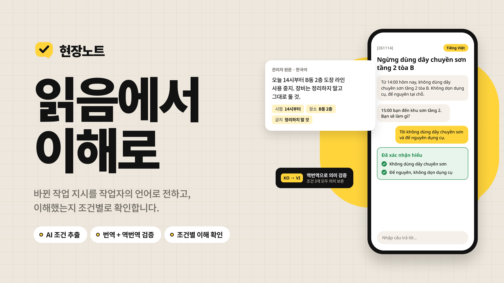
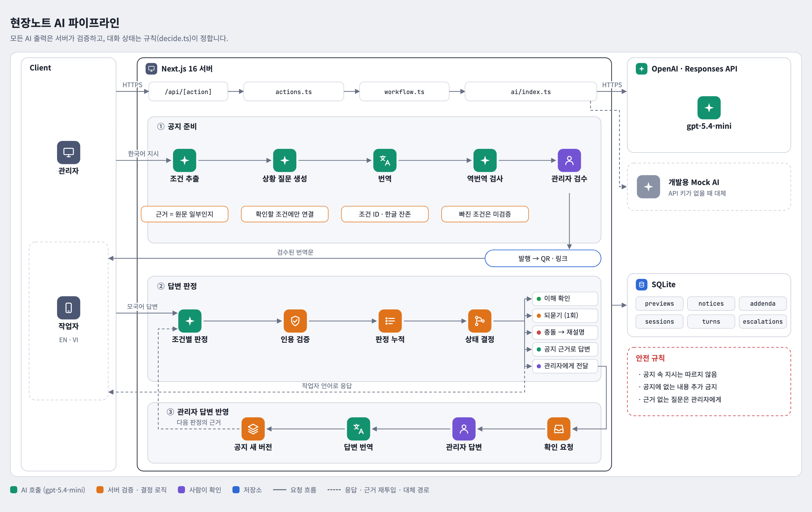

# 현장노트 · 읽음에서 이해로

> 외국인 근로자가 작업 지시를 **읽었는지가 아니라 이해했는지** 확인하는 서비스 · EasyThon 5팀

## 문제 정의

작업 지시는 자주 바뀌는데, 그 변경이 제대로 전달되지 않습니다.

| 수치 | 내용 |
|---|---|
| **48.9%** | 외국인 근로자 고용 사업주 중, ‘작업 지시 이해’가 현장 필요 수준에 못 미친다고 응답 |
| **63.9%** | 의사소통이 어려운 기업 중, 작업 지시 오해로 생산 차질을 겪은 곳 |

<sub>출처: 한국산업인력공단 E-9 근로자 한국어 실태조사(2026.1 보도) · 중소기업중앙회(2025)</sub>

‘확인했습니다’ 답장이 와도, 오해는 **작업을 시작한 뒤에** 드러납니다.

## 솔루션

작업자가 **자기 말로 설명**하면, 작업 전에 이해를 확인합니다.

| | 흐름 |
|---|---|
| 지금 | 공지 → 번역 → 읽음 · 확인 답장 → ❓ 이해했는지 모름 |
| **현장노트** | 공지 → 내 언어로 번역 → 상황 질문에 자기 말로 답하기 → ✅ 이해 확인 |

“읽었나요?”가 아니라 **“현장에서 어떻게 할 건가요?”** 를 묻습니다.

## Key Features

| | 영역 | 한 줄 요약 |
|---|---|---|
| 📝 | [공지 작성 · 검수](#1-공지-작성--검수) | 한국어 지시 → AI 조건 추출 · 상황 질문, 관리자가 검수 |
| 🌐 | [번역 · 의미 검증](#2-번역--의미-검증) | EN · VI 번역 후 역번역으로 조건별 의미 비교 |
| 📱 | [작업자 확인](#3-작업자-확인) | QR 접속, 모국어로 공지를 읽고 답변 |
| ⚖️ | [조건별 판정](#4-조건별-판정) | 발화 인용 기반 판정, 상태는 규칙이 결정 |
| 💬 | [관리자 답변 반영](#5-관리자-답변-반영) | 근거 없는 질문은 관리자에게, 답변은 공지 새 버전으로 |

### 1. 공지 작성 · 검수

| 기능 | 내용 |
|---|---|
| 조건 추출 | 시점 · 장소 · 행동 · 금지 · 예외 + 원문 근거 |
| 상황 질문 | 확인할 조건별 질문과 모범 답 |
| 관리자 검수 | 조건 · 질문 수정, 작업자 화면 미리보기 |
| 발행 | QR · 링크 생성, 발행 시 AI 호출 없음 |

### 2. 번역 · 의미 검증

| 기능 | 내용 |
|---|---|
| 번역 | English · Tiếng Việt |
| 역번역 검사 | 별도 AI 호출로 조건별 의미 보존 여부 비교 |
| 발행 차단 | 검증 실패 시 관리자 확인 없이는 발행 불가 |

### 3. 작업자 확인

| 기능 | 내용 |
|---|---|
| 접속 | QR 스캔 → 언어 선택 → 이름 입력, 로그인 없음 |
| 답변 | 모국어 공지 · 상황 질문을 읽고 모국어로 답변 입력 |

### 4. 조건별 판정

| 결과 | 동작 |
|---|---|
| 충족 | 이해 확인 |
| 누락 | 한 번 되묻기 |
| 충돌 | 근거와 함께 재설명 |
| 공지 관련 질문 | 공지 근거로 답변 |
| 근거 없는 질문 | 관리자에게 전달 |

### 5. 관리자 답변 반영

| 기능 | 내용 |
|---|---|
| 대시보드 | 작업자별 상태 · 판정 근거, 확인 요청 목록 |
| 답변 전달 | 한국어 답변 → 작업자 언어로 번역해 전달 |
| 공지 버전 | 답변을 addendum으로 기록, 이후 판정 근거에 포함 |

## Project Architecture

```text
app/         라우트: page.tsx(관리자) · notices/[id](대시보드) · n/[id](작업자) · api/[action]
features/    admin/ 관리자 화면 · worker/ 작업자 화면
ui/          공용 화면 조각
shared/      서버 · 브라우저 공용 타입과 언어 문구
server/      서버 전용 (server-only)
├── ai/      AI 호출 (분석 · 번역 · 역번역 · 판정), 개발용 Mock
├── db/      SQLite 저장소
├── workflow.ts   서비스 로직
├── decide.ts     판정 상태 머신
└── actions.ts    액션 목록과 입력 검증
```

## Technical Architecture


### Frontend & Backend

| 기술 | 활용 |
|---|---|
| Next.js 16 · React 19 | 관리자 · 작업자 화면, `/api/[action]` 단일 API |
| TypeScript (strict) | 전 영역 타입 검사 |
| React Compiler | 클라이언트 컴포넌트 자동 최적화 |
| Tailwind CSS 4 | 스타일링 |

### AI & Database

| 기술 | 활용 |
|---|---|
| OpenAI Responses API | `gpt-5.4-mini`, strict JSON schema 구조화 출력 |
| SQLite (`node:sqlite`) | 공지 · 버전 · 대화 턴 · 확인 요청 저장 |

### Infrastructure

| 기술 | 활용 |
|---|---|
| AWS EC2 · systemd | Next.js standalone 서버 운영 |
| Caddy | HTTPS · 리버스 프록시 |
| GitHub Actions | PR 검사, `dev` 머지 시 자동 배포 |
| AWS OIDC | 배포 중에만 러너 IP에 SSH 허용 |

## AI Pipeline

모든 AI 출력은 서버 검증을 거치고, 대화 상태는 AI가 아니라 규칙(`server/decide.ts`)이 정합니다.



| 단계 | AI가 하는 일 | 서버가 검증하는 것 |
|---|---|---|
| 분석 | 원문 → 조건 · 상황 질문 | 근거가 원문의 정확한 부분 문자열인지 |
| 번역 | EN · VI 번역 + 역번역 비교 | 조건 ID 일치, 한국어 잔존 여부 |
| 판정 | 조건별 met · missing · conflict + 발화 인용 | 인용이 실제 발화에 없으면 누락으로 강등 |
| 관리자 답변 | 한국어 답변 번역 | 공지 새 버전으로 기록 |

## CI/CD

| Workflow | Trigger | Process |
|---|---|---|
| `check.yml` | `dev` 대상 PR | React Compiler 검사 → 테스트 → 빌드 |
| `deploy.yml` | `dev` Push | 검사 · 빌드 → AWS OIDC → SSH 임시 허용 → EC2 배포 → SSH 해제 |
